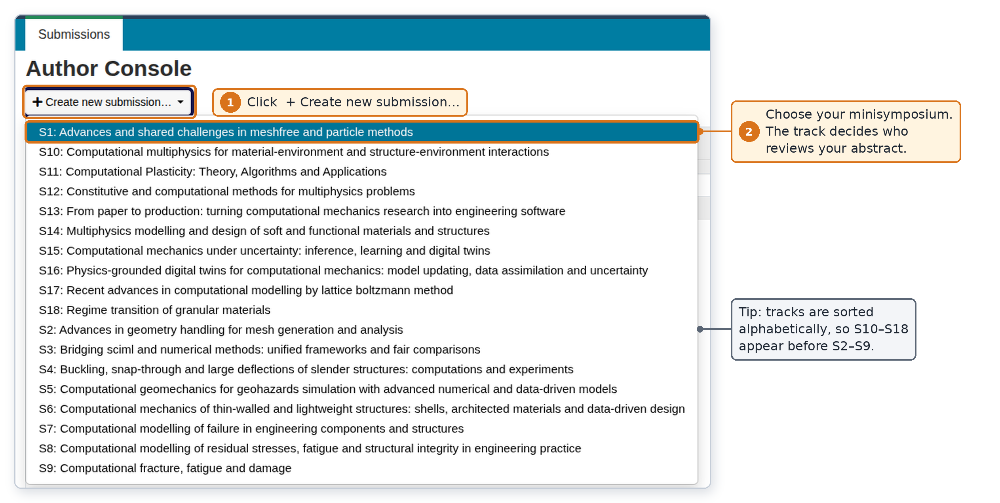
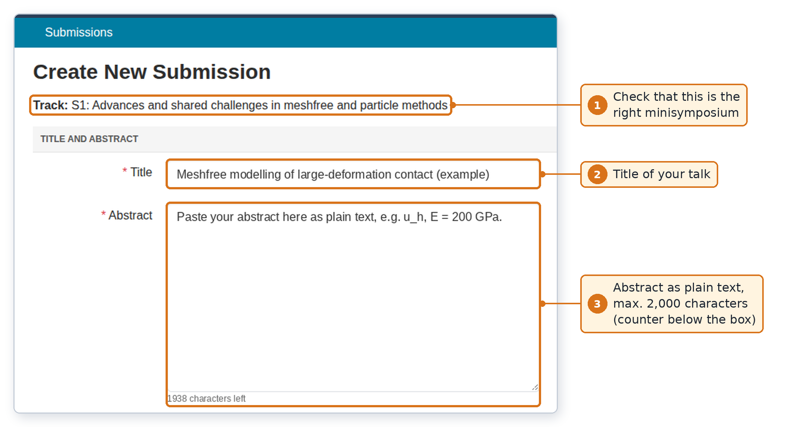
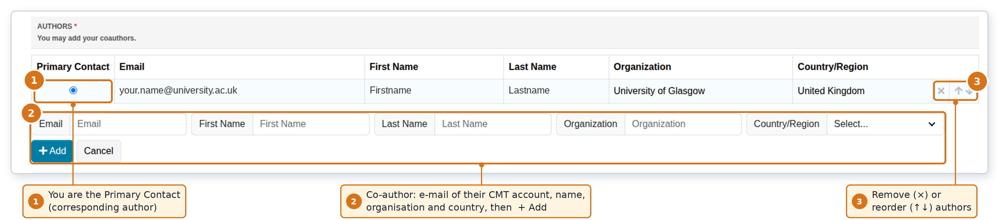
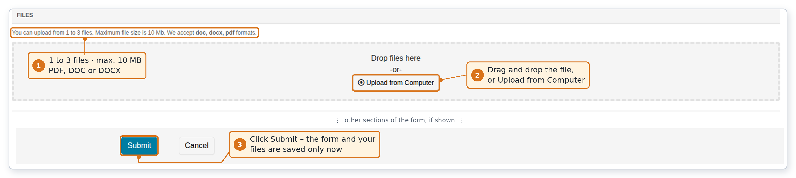
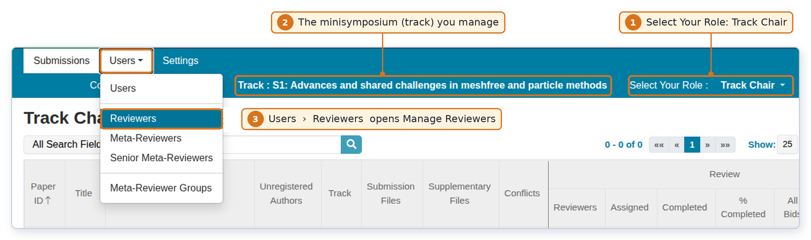
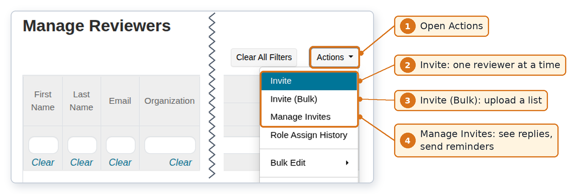
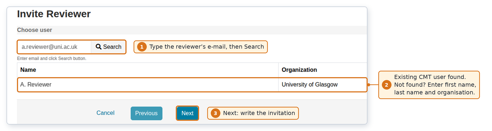
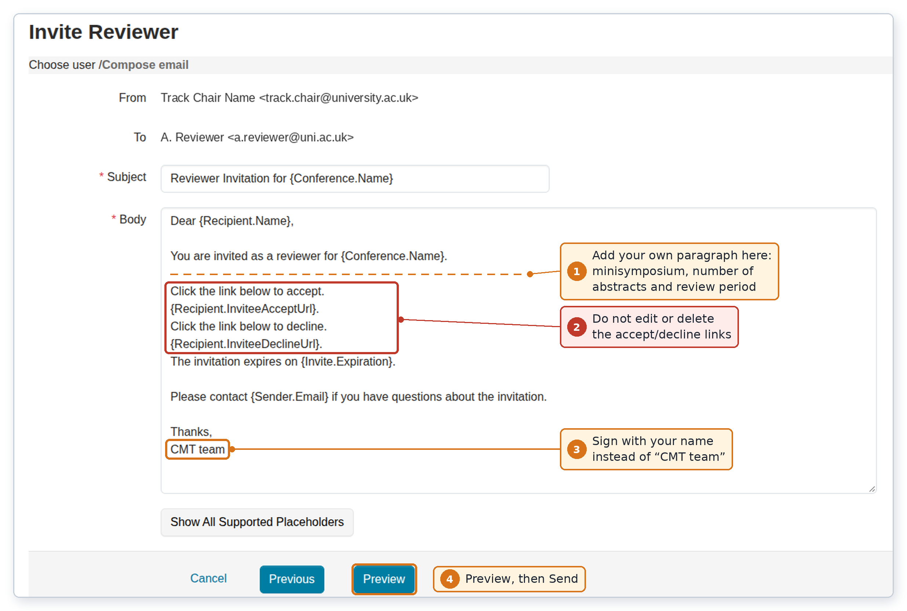
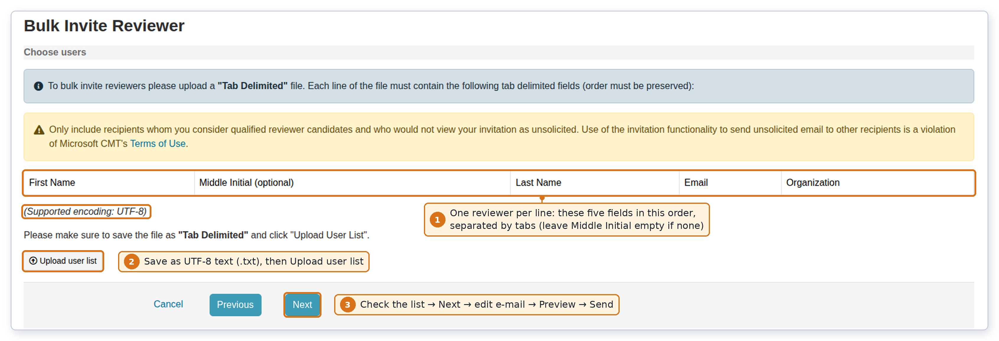

Abstracts for  are submitted and reviewed in **Microsoft CMT**
at 

**[]()**

Each mini-symposium
() is a separate **track** in CMT, run by its **track
chairs** (the mini-symposium organisers); CMT calls an abstract a **submission**.
Please read the section for your role:

- **authors** → @sec-authors;
- **track chairs** → @sec-trackchairs; 
- **reviewers** → @sec-reviewers.

`@msr-cmt.org` address: check your spam folder and, if necessary, ask your IT
service to allow **msr-cmt.org**.

| Milestone                                         | Date                                       |
|:--------------------------------------------------|:-------------------------------------------|
| Abstract submission opens                         |                     |
| **Abstract submission deadline**                  | ****   |
| Authors notified of the decision                  |                   |
: Key dates for  (, ). {#tbl-dates tbl-colwidths="[58,42]"}

<!-- | Track chairs send reviewer invitations            |                | -->
<!-- | Track chairs assign abstracts to reviewers        |                | -->
<!-- | Reviews completed                                 |          | -->
<!-- | Track chairs send recommendations to organisers   |             | -->


# For authors: submitting an abstract {#sec-authors}

**Step 1 — Account.** If you have used CMT before, log in with that account.
Otherwise register at <https://cmt3.research.microsoft.com/User/Register> with an
institutional e-mail address you will keep, and confirm the verification e-mail.

**Step 2 — Open the conference.** Use the link
**[]()**. If CMT reports
*"Trying to access resource not allowed"*, go to
<https://cmt3.research.microsoft.com>, open **All Conferences**, type
*UKACM 2027* slowly into the search box (do not press Enter) and click the
conference name. You arrive at the **Author Console**.

**Step 3 — Choose your track (mini-symposium or general session).** Click **+ Create new submission…** and
select your mini-symposium from the list (@fig-author-console). This decides which
track chairs and reviewers handle your abstract. Note that the list is sorted
alphabetically, so S10–S19 appear before S2. **Remark:** If you cannot find a suitable mini-symposium for your abstract, please check the general sessions.

{#fig-author-console width="68%"}

**Step 4 — Complete the form.** The *Create New Submission* page shows the
selected track at the top; check it before you continue (@fig-title-abstract).
Fields marked with a red asterisk (\*) are required.

- **Title and Abstract.** Enter the title of your talk and paste the abstract as
  plain text (at most ; the counter
  below the box shows how many remain). Avoid LaTeX commands; write simple
  notation such as `u_h` or `E = 200 GPa`.

{#fig-title-abstract width="58%"}

- **Authors** (@fig-authors). You are listed as the *Primary Contact*
  (corresponding author). For each co-author, enter e-mail, first name, last
  name, organisation and country, then click **+ Add**. Use the e-mail address
  of the co-author's own CMT account: CMT does not check it, and co-authors who
  never register under that address receive no conference e-mails. Use × and
  ↑↓ to remove or reorder authors.

{#fig-authors width="100%"}

- **Other sections** (if shown) — for example *Domain Conflicts* (the e-mail
  domains of your institutions, such as `gla.ac.uk`, but not `gmail.com`),
  *Subject Areas* or *Additional Questions*. Answer all required ones.
- **Files and Submit** (@fig-files). Upload your abstract prepared with the
  [](): up to
   files,  each,
  . Drag the file into the dashed box or click
  **Upload from Computer**, then click **Submit**. Nothing, including uploaded
  files, is saved until you click **Submit**.

{#fig-files width="100%"}

**Step 5 — After submitting.** CMT shows your **Paper ID** and e-mails a
confirmation to all authors; the abstract now appears in your Author Console.
Until the deadline you can use **Edit Submission** or **Delete Submission** in
the *Actions* column. If these links are missing, the phase is closed; write to
 (not to Microsoft CMT support).

# For mini-symposium organiser (track chair) {#sec-trackchairs}

## Important

As soon as you have created your CMT account, please let us know by email so that we can assign your role as **Track Chair**. As a track chair, you can invite reviewers (including mini-symposium co-organisers) and also act as a reviewer yourself.

## Getting started

Make sure you have a CMT account (Step 1 above) and send the exact e-mail address you use for your account
to ; we will give it the *Track Chair* role for your
mini-symposium. Log in, open  and choose **Track Chair** in
**Select Your Role** (@fig-track-nav, 1). The blue bar then shows the track you
manage (2), and the **Track Chair Console** lists only the abstracts of that
track. Reviewers are managed under **Users › Reviewers** (3).

{#fig-track-nav width="88%"}

<!-- **How many reviewers?** Each abstract needs
** reviews** and no reviewer should get
more than ****. For $N$ expected abstracts, $k$
reviews each and a maximum load $L$, invite about $R \approx 1.5\,Nk/L$ people
(e.g. $N=20$, $k=2$, $L=5$ gives $R\approx 12$), by ,
to allow for people who decline or do not reply. -->

**Invite or assign?** *Invite* people who are not yet reviewers in your track;
they join only after accepting. Anyone already listed on your **Manage
Reviewers** page must not be invited again — just *assign* abstracts to them.
Invitations are per track. Only invite people who would expect to hear from you:
CMT's terms forbid unsolicited bulk e-mail.

## Invite one reviewer

1. On **Manage Reviewers**, open **Actions › Invite** (@fig-actions).
2. Type the reviewer's e-mail address and click **Search** (@fig-invite-search).
   If the person already has a CMT account, CMT shows their name and
   organisation. If not, enter first name, last name and organisation and click
   **Create Invite**; the reviewer will register when accepting. Click **Next**.
3. Edit the invitation (@fig-invite-compose). The message is sent by CMT under
   your name and asks reviewers to contact your e-mail address. Add a short personal
   paragraph, sign with your name, click **Preview** and then **Send**.

{#fig-actions width="66%"}

{#fig-invite-search width="84%"}

{#fig-invite-compose width="74%"}

::: {.callout-tip}
## Suggested paragraph (paste below "You are invited as a reviewer…")

I am organising the mini-symposium "‹title›" at 
(, ). Would you review
about ‹L› short abstracts between ‹date› and ‹date›? Each review takes about
15 minutes. If you have no Microsoft CMT account yet, please register with
*this* e-mail address before clicking the accept link.
:::

Words in curly brackets such as `{Recipient.Name}` are placeholders that CMT
fills in for each reviewer (**Show All Supported Placeholders** lists them).
Never edit or delete `{Recipient.InviteeAcceptUrl}` or
`{Recipient.InviteeDeclineUrl}`, otherwise the reviewer cannot respond. The
invitation text cannot be saved as a template, so keep your paragraph in a
separate file.

## Invite many reviewers at once

Choose **Actions › Invite (Bulk)** and upload a plain-text list (@fig-bulk).

{#fig-bulk width="100%"}

Prepare one line per reviewer with exactly these five fields, separated by tabs
and **without a header row**; leave *Middle Initial* empty if there is none:

| First Name | Middle Initial | Last Name | Email                | Organization          |
|:-----------|:---------------|:----------|:---------------------|:----------------------|
| Jane       |                | Smith     | jane.smith@uni.ac.uk | University of Example |
| Rui        | M              | Costa     | r.costa@inst.edu     | Example Institute     |

: Example rows for the bulk-invitation file (columns A–E of a spreadsheet). {#tbl-bulk tbl-colwidths="[15,15,14,28,28]"}

The file must be **UTF-8** text. The simplest route is a Google Sheet exported
with **File › Download › Tab-separated values (.tsv)**; rename the file to `.txt`
if the upload dialog does not accept `.tsv`. Excel's *Text (Tab delimited)*
format is fine for names without accents but may corrupt names such as
*Müller* or *Łukasz*. Click **Upload user list**, check the parsed names, click
**Next**, edit the message as for a single invitation, **Preview** each e-mail
and **Send**.

## Follow up on invitations

Open **Actions › Manage Invites** to see the status of every invitation.

- *Accepted* reviewers appear on **Manage Reviewers** and can receive abstracts.
  For *Declined* ones, invite a replacement.
- **Reminders:** filter the *Status* column for *Not Responded*, then use
  **Actions › Email**. Do **not** use **Bulk Resend Invites**: resending voids the
  earlier links and resets accepted reviewers to *Not Responded*.
- If *Not Responded* is not shown as a blue link, the person has no CMT account
  yet. They must register with **exactly** the invited address and then click
  the accept link again. Invitations expire on the date stated in the e-mail.

## Assign abstracts and follow the reviews

After the abstract deadline, give every abstract
at least  reviewer:

- **Per abstract:** in the Track Chair Console, **More › Edit Assignments ›
  Reviewer** at the end of the abstract's row, then tick reviewers in the
  *Assign* column.
- **Per reviewer:** on **Manage Reviewers**, **More › Edit Assignments** at the
  end of the reviewer's row, then tick abstracts. The *Assigned* column shows each
  reviewer's load.
- **Automatic:** **Actions › Automatic Assignment › Reviewer** in the Track Chair
  Console; check the proposal and click **Save assignments**.

CMT hides reviewers who have a domain conflict with an author. If a
**Notify Assignment?** pop-up appears, click **Yes**; otherwise filter **Manage
Reviewers** for *Assigned* `>0` and use **Actions › Email**, e.g. with this
template:

```text
Dear {Recipient.FirstName},
You have been assigned the following abstract(s) for {Conference.Name}:
{Review.AssignedDetail}
Please log in at https://cmt3.research.microsoft.com, choose the role
"Reviewer" and submit your reviews by <review deadline>.
Best wishes, {Sender.Name}
```

Tell  when your assignments are complete: reviewers see
their abstracts only once we open the reviewing phase. Chase late reviewers with
**Actions › Email › Reviewers (Not Completed)** in the console.

# For reviewers {#sec-reviewers}

**Accepting the invitation.** Click the accept link in the invitation e-mail. If
you do not yet have a CMT account, first register at
<https://cmt3.research.microsoft.com/User/Register> with the **same e-mail
address** the invitation was sent to, verify it, and click the accept link again.
When asked, enter the e-mail domains of your institutions as *domain conflicts*.
Accepting gives you the Reviewer role; your console stays empty until abstracts
are assigned and reviewing opens.

**Writing your reviews.** When the track chair tells you that reviewing is open:

1. Log in at <https://cmt3.research.microsoft.com>, open 
   and choose **Reviewer** in **Select Your Role**.
2. The **Reviewer Console** lists your assigned abstracts. Download the file(s)
   of each abstract from its row.
3. Click **Enter Review**, answer the questions of the review form and click
   **Submit**. You can change it with **Edit Review**.

# Contact

If you need any support during the process, please contact us via ****.

Conference website: []().

<!-- # Troubleshooting {#sec-troubleshooting}

| Problem                                                       | Solution                                                                                                 |
|:--------------------------------------------------------------|:---------------------------------------------------------------------------------------------------------|
| No **+ Create new submission** button, or a track is missing. | Submission is not open (see @tbl-dates); otherwise contact us.                                           |
| *"Trying to access resource not allowed"*.                    | Start from the main CMT page and search for the conference (Step 2).                                     |
| No e-mails from CMT.                                          | Check the spam folder; allow `msr-cmt.org`.                                                              |
| A co-author cannot see the abstract.                          | Their CMT account uses a different e-mail address; correct the author entry.                             |
| Bulk upload shows wrong names or characters.                  | The file is not UTF-8 or has a header row; export it again as described above.                           |
| Reviewer accepted but is not on **Manage Reviewers**.         | They registered with a different address; check **Manage Invites** and contact us.                      |
| Accept link says the invitation expired.                      | It was resent or timed out; the track chair resends that single invitation.                              |
| Reviewer sees no abstracts.                                   | Nothing assigned yet, or reviewing is not open yet.                                                      |
| Abstract submitted to the wrong mini-symposium.                | Contact us before reviewing starts; reviews do not move with the abstract.                               |

: Common problems. {#tbl-trouble tbl-colwidths="[40,60]"} -->


